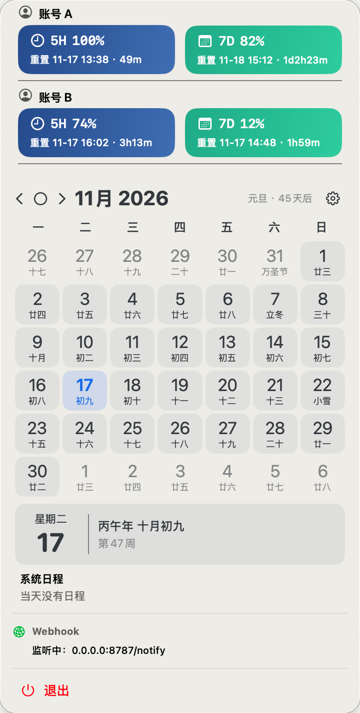

# AmazeyinBar

**用量、日历、通知，一眼尽览。** AmazeyinBar 常驻 macOS 菜单栏，集中展示多个 ChatGPT 账号的 5H / 7D 用量、当天日期与月历，也能把任意服务的 Webhook 消息送到系统通知。



*当前版本实拍；账号名称已匿名化。*

## v1.0.7 更新

- 新增月历：农历、节日节气、法定节假日与调休、系统日程一处查看；点标题右侧齿轮进入设置。
- 状态栏同时显示用量圆环和日期，可选择 5H、7D 或全部，并设置显示账号数。
- 用量卡片紧凑呈现重置时间与倒计时；弹窗默认展示两个账号，更多账号可滚动查看。
- 新增开机自启与局域网音频接收开关；锁屏期间暂停用量刷新，解锁后继续。
- 更新界面配色与布局，保留通用 Webhook 通知及原有账号导入方式。

## 功能

- 状态栏以圆环显示账号 5H、7D 用量及公历日期、星期；可配置显示模式与账号数量（1–10 个）。
- 月历显示农历、节日、节气、中国法定节假日与补班标记，并可查看 macOS 系统日程。
- 下拉菜单以蓝色 5H 卡片、绿色 7D 卡片展示用量、重置时间与倒计时，并可切换到设置页。
- 支持定时刷新和“立即刷新”。
- 锁屏期间暂停额度刷新，解锁后立即更新。
- 支持从剪贴板粘贴 ChatGPT 请求 cURL 导入账号。
- 支持从当前 Chrome 页面导入账号或账号后台数据。
- 支持通过 Sub2API Admin API Key 导入后台账号，无需保持 Chrome 登录。
- 内置本地 Webhook 接收端，可接收任意服务的事件通知；Jenkins 构建通知只是其中一种调用示例。
- 使用 macOS 原生通知通道与系统默认提示音；通知展示策略由用户在系统设置中控制。
- 内置局域网音频接收端，可播放 Windows 发送端采集的系统声音。
- 支持一键打开配置、显示配置目录、复制 Webhook cURL 示例与发送本机测试通知。

## 安装

从 [Releases](https://github.com/amazeyin2/AmazeyinBar/releases) 下载最新的 `AmazeyinBar-macos.zip`，解压后将 `AmazeyinBar.app` 拖入“应用程序”目录并启动。

首次启动会生成配置文件：

`~/Library/Application Support/GPTUsageBar/config.json`

若需要桌面通知，请在“系统设置 -> 通知 -> AmazeyinBar”中启用所需的横幅、通知中心、锁定屏幕和声音选项。

## 配置

### 日历

菜单栏日期按本机时区显示。点击日历标题右侧的齿轮可进入设置，设置页左上角可返回日历；月历支持切换月份、返回今天、查看所选日期的农历、节气、节日、休班安排及系统日程。设置页可以分别关闭系统日程、农历、节日和节气、节假日倒计时及调休标记，也可通过“开机自启”开关管理 macOS 登录项。若系统要求批准，请到“系统设置 > 通用 > 登录项与扩展”中允许 AmazeyinBar。

系统日程需要 macOS 日历访问权限，拒绝权限后仍可查看其他日期信息。中国法定节假日及调休来自 [holiday-cn](https://github.com/NateScarlet/holiday-cn)，按年下载并缓存到 `~/Library/Application Support/GPTUsageBar/holidays/`，每天检查更新。离线时使用缓存；未公布的年份不会推测放假安排。数据源采用 MIT 许可，Copyright © 2019 NateScarlet，详见[原项目许可证](https://github.com/NateScarlet/holiday-cn/blob/master/LICENSE)。节气使用本地近似算法计算。

### Windows 音频传到 Mac

在菜单中的“允许远程锁屏请求”下方打开“允许传音”。AmazeyinBar 会监听 UDP `49831`，等待 Windows 端发送音频；开关状态保存到配置文件，并在下次启动时恢复。关闭开关即停止接收并释放端口。独立版 `LanAudioReceiver` 使用相同端口，使用内置接收端前请先退出独立版。

在 Windows 上运行现有的 `LanAudioSender.exe`，传入 Mac 的局域网 IPv4 地址，例如 `LanAudioSender.exe 你的Mac局域网IP`。播放使用 Mac 当前默认音频输出设备。若菜单显示“端口 49831 被占用”，退出其他接收程序后关闭再打开开关即可重试。

以下是一个脱敏示例。请勿将真实 token、Cookie、Admin API Key 或 Webhook 密钥提交到仓库。

```json
{
  "refreshIntervalSeconds": 300,
  "titleMode": "compact",
  "statusBarAccountLimit": 2,
  "allowAudioReceiving": false,
  "accounts": [
    {
      "id": 1,
      "name": "主账号",
      "baseURL": "https://sub.example.com",
      "timezone": "Asia/Shanghai",
      "source": "active",
      "enabled": true
    }
  ],
  "importOptions": {
    "chromeAccountsURL": "https://sub.example.com/admin/accounts",
    "includePlatforms": ["openai"],
    "includeDisabledAccounts": false
  },
  "webhook": {
    "enabled": true,
    "bindAddress": "0.0.0.0",
    "port": 8787,
    "path": "/notify",
    "token": "REPLACE_WITH_WEBHOOK_TOKEN",
    "allowLockRequests": false
  }
}
```

### 状态栏模式

- `fiveHour`：显示每个账号的蓝色 5H 用量圆环。
- `sevenDay`：显示每个账号的绿色 7D 用量圆环。
- `compact`：每个账号同时显示 5H 与 7D 圆环。

`statusBarAccountLimit` 控制状态栏最多显示的账号数，可在菜单中选 1–10 个；旧配置默认显示 2 个，超出的账号以 `+N` 提示。

## 导入账号

### 通过 Sub2API Admin API Key 导入（推荐）

适用于使用 [sub2api](https://github.com/Wei-Shaw/sub2api) 的账号后台。管理员在后台生成 Admin API Key 后，选择菜单中的“通过 Sub2API API Key 导入账号”，填写后台地址并粘贴 `admin-...` 密钥即可。App 只会导入平台筛选匹配、状态正常且“调度”开关已启用的 OpenAI 账号；再次导入会同步移除该后台中已关闭调度的已导入账号。额度通过 `x-api-key` 查询，不需要连接或保持 Chrome 登录。

密钥仅保存于 macOS Keychain，`config.json` 不会保存它。该密钥拥有后台管理员权限，请仅在自己的受信任 Mac 上使用；重新生成或删除密钥后，需要再次导入。

### 从剪贴板 cURL 导入

在已登录的 `chatgpt.com` 页面打开浏览器开发者工具，选择一条需要授权的 ChatGPT 请求并使用“Copy as cURL”。复制后，在 AmazeyinBar 菜单中选择“从剪贴板 cURL 导入 ChatGPT 账号”。

仅使用你自己的登录会话。cURL 中的授权信息等同于登录凭据，不应发送给他人或提交到 Git。

### 从当前 Chrome 页面导入

打开已登录的 `chatgpt.com` 页面或已配置的账号后台页面，再从菜单选择“从当前 Chrome 页面导入账号”。该功能需要 Chrome 开启远程调试并能被本机应用访问。对于 Sub2API 后台账号，优先使用上方的 Admin API Key 导入方式，避免短期浏览器会话 Token 失效。

## Webhook 通知

默认接收地址为：

```text
http://<Mac 局域网 IP>:8787/notify
```

启用 `token` 后，可使用查询参数或请求头传递：

```bash
curl -X POST "http://<Mac 局域网 IP>:8787/notify?token=REPLACE_WITH_WEBHOOK_TOKEN" \
  -H "Content-Type: application/json" \
  -d '{"title":"部署服务","subtitle":"任务完成","message":"生产环境已成功发布","sound":true}'
```

Jenkins 可按同一接口推送构建结果，也可以接入 CI/CD、监控告警、定时任务或任何能够发送 HTTP 请求的服务。

### 锁屏与唤醒显示器

Webhook 启用后，以下端点与 `/notify` 共用相同的 `token` 校验。`/lock` 默认关闭；在配置文件的 `webhook` 中将 `allowLockRequests` 设为 `true` 后才会接受锁屏请求：

```json
"allowLockRequests": true
```

```bash
# 立即让显示器休眠；是否要求密码由 macOS“锁定屏幕”设置决定。
curl -X POST "http://<Mac 局域网 IP>:8787/lock?token=REPLACE_WITH_WEBHOOK_TOKEN"

# 唤醒显示器；若当前会话已经锁定，仍必须由用户使用密码、Touch ID 等方式解锁。
curl -X POST "http://<Mac 局域网 IP>:8787/unlock?token=REPLACE_WITH_WEBHOOK_TOKEN"
```

`/unlock` 不会、也不能绕过 macOS 的登录认证。请务必设置高强度 `token`，并避免将 `8787` 端口暴露到公网。

请求体字段：

- `title`：通知标题，必填。
- `subtitle`：通知副标题，可选。
- `message`：通知正文，必填。
- `sound`：是否播放系统默认提示音，默认 `true`。
- `url`：预留跳转地址，可选。

## 本地开发

要求：macOS 14+、Xcode Command Line Tools、Swift 6。

```bash
git clone https://github.com/amazeyin2/AmazeyinBar.git
cd AmazeyinBar
swift run GPTUsageBar
```

构建 App：

```bash
chmod +x scripts/build-app.sh
./scripts/build-app.sh
open dist/AmazeyinBar.app
```

## 发布

推送 `v*` 标签会自动触发 GitHub Actions，在 macOS 构建并创建包含 `AmazeyinBar-macos.zip` 的 Release。

```bash
git tag -a v1.0.7 -m "AmazeyinBar v1.0.7"
git push origin v1.0.7
```
