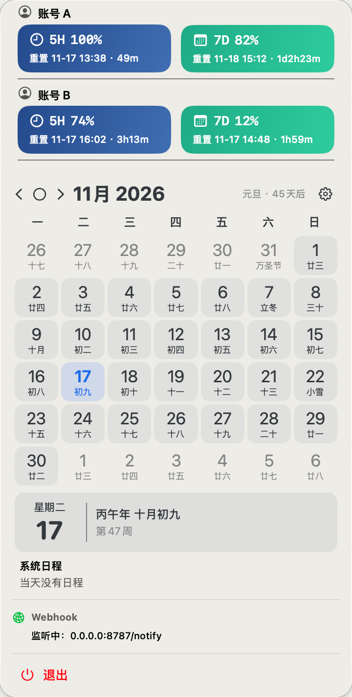

# AmazeyinBar v1.0.7

一个菜单栏，同时照看 ChatGPT 用量、日历和来自任意服务的 Webhook 通知。

## 新增与改进

- 状态栏加入日期和星期；用量圆环支持 5H、7D、全部三种显示模式，以及 1–10 个账号的数量配置。
- 弹窗新增月历，可查看农历、节日节气、法定节假日、补班安排和 macOS 系统日程；日历与设置由齿轮及返回按钮切换。
- 用量卡片改为紧凑的单行重置时间与倒计时，默认完整展示两个账号，并取消卡片阴影。
- 设置中新增开机自启和局域网音频接收开关；锁屏期间暂停用量刷新。
- 保留 Sub2API API Key、Chrome 页面和 ChatGPT cURL 导入，以及通用 Webhook 原生通知。

截图中的账号名称已匿名化。下载 `AmazeyinBar-macos.zip` 后，解压并将 App 拖入“应用程序”目录。macOS 14 或更高版本适用。
